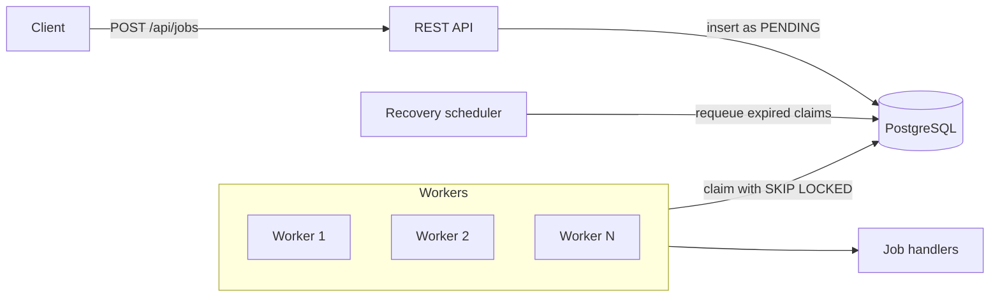
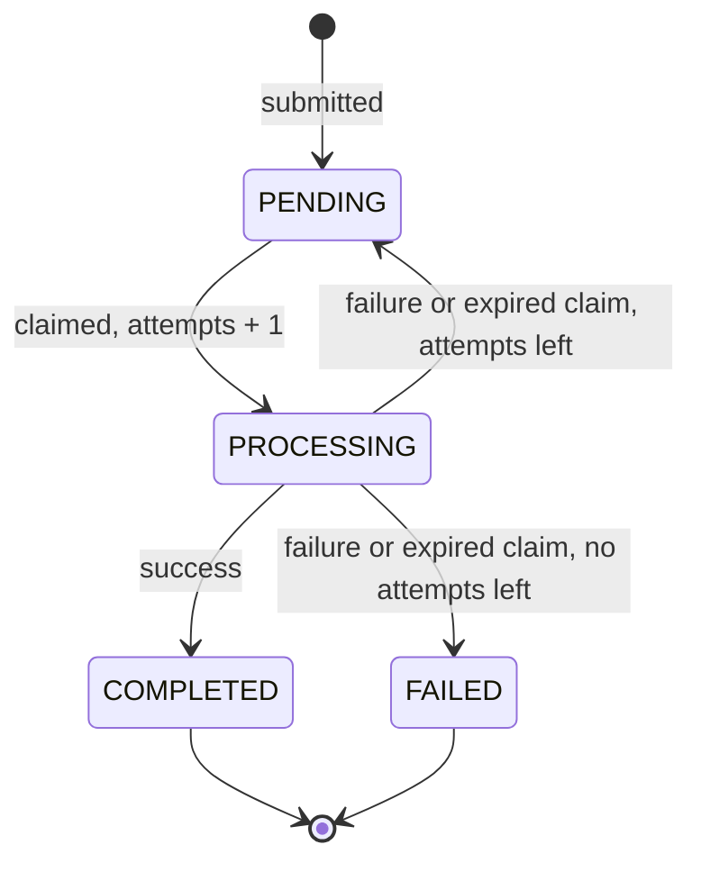

# ClaimQ

A PostgreSQL-backed background job queue built with Java 21 and Spring Boot. Jobs are submitted over REST, claimed by concurrent workers, and run asynchronously. PostgreSQL is the single source of truth, so workers are stateless and replaceable.

## Features

- Safe concurrent claiming with `FOR UPDATE SKIP LOCKED`
- Claim tokens, so a stale worker can never overwrite a newer claim
- Delayed retries with a retry limit
- Recovery of jobs abandoned by crashed workers
- Configurable worker pool with graceful shutdown
- Job status lookup and filtered listing over REST

Built with Java 21, Spring Boot, Spring JDBC (`JdbcTemplate`), PostgreSQL, Flyway, Maven and JUnit 5.

## Architecture



## Job lifecycle



Attempts are counted when a job is claimed, so `max_attempts` is the maximum number of executions.


## Delivery guarantee

ClaimQ provides **at-least-once** delivery. An expired lease does not prove the original worker has stopped, so a job can occasionally run more than once. Handlers must be safe to run repeatedly.

## Getting started

Requirements: Java 21, Maven, and PostgreSQL 13 or newer.

**1. Create the databases**

```sql
CREATE USER claimq_user WITH PASSWORD 'change-me';
CREATE DATABASE claimq OWNER claimq_user;
CREATE DATABASE claimq_test OWNER claimq_user;
```

**2. Provide credentials**

```bash
export DB_USER=claimq_user
export DB_PASSWORD=change-me
```

**3. Run**

```bash
./mvnw spring-boot:run
```

Flyway creates the schema on startup, and the API listens on port 8080.

**4. Submit a job**

```bash
curl -X POST localhost:8080/api/jobs \
  -H 'Content-Type: application/json' \
  -d '{"taskType":"demo","payload":{"msg":"hello"}}'

curl localhost:8080/api/jobs/1
```

The job moves from `PENDING` to `PROCESSING` to `COMPLETED` within a few seconds.

## API

| Method | Endpoint | Description |
|---|---|---|
| POST | `/api/jobs` | Submit a job. Returns `202` with the job |
| GET | `/api/jobs/{id}` | Get one job |
| GET | `/api/jobs` | List jobs, newest first. Optional `status`, `page` (from 0) and `size` (default 20, maximum 100) |

Request body for `POST /api/jobs`:

| Field | Required | Description |
|---|---|---|
| `taskType` | yes | Must match a registered handler |
| `payload` | yes | Any valid JSON |
| `maxAttempts` | no | 1 to 10, default 3 |

Errors use the standard problem details format: `400` for invalid input or an unknown task type, `404` for an unknown id. Responses never expose the claim token or worker id.


## Configuration

| Property | Default | Description |
|---|---|---|
| `claimq.worker.count` | `3` | Number of worker threads |
| `claimq.worker.poll-interval` | `1s` | How often an idle worker polls |
| `claimq.worker.lease-timeout` | `60s` | How long a claim is valid before recovery may reclaim it |
| `claimq.recovery.interval` | `15000` | Milliseconds between recovery runs |
| `claimq.retry.base-delay` | `5s` | Base retry delay |
| `claimq.retry.max-delay` | `60s` | Maximum retry delay |
| `claimq.shutdown.grace-period` | `30s` | How long shutdown waits for running jobs |


